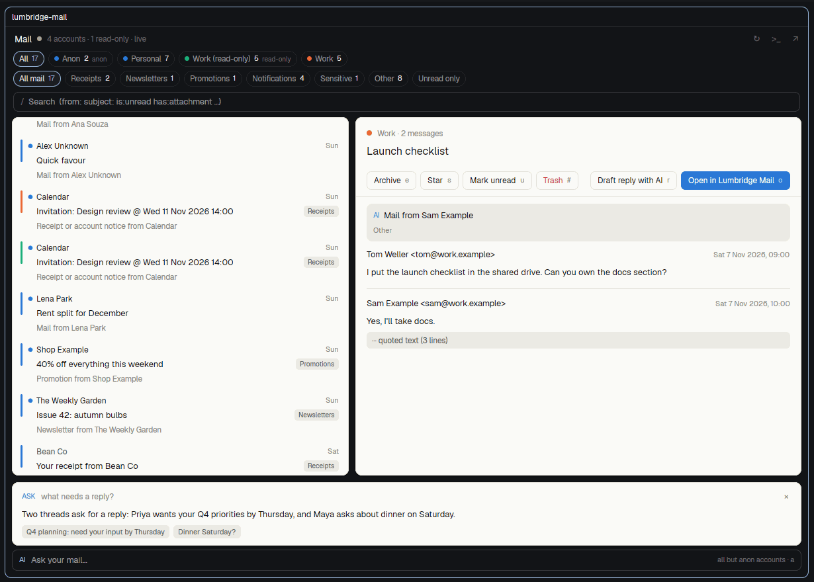

# Lumbridge Mods

Mods for the [Lumbridge desktop app](https://github.com/lumbridge-corp/lumbridge-app): small JavaScript panels and
dialogs that run inside the window, beside your terminals. This repo has three you can use as they are, the shared
helper kit they are built on, and the scripts that check and install them. It is also a worked example of how to
write your own.

Part of [Lumbridge](https://lumbridgecorp.com) ([all repositories](https://github.com/lumbridge-corp)). In daily use.

## Status

- **Version:** 0.1.0. Interfaces can change until 1.0; mods follow the app's mod API, which can change too.
- **Runs on:** wherever Lumbridge runs (Linux and macOS). The steps below are tested on Ubuntu 24.04.
- **Not yet:**
  - No packaged release: you copy the mods in with `scripts/install.sh`.
  - The CI on GitHub checks syntax and runs the logic tests only; `lumbridge-app check` (which loads and renders each
    mod) needs the app installed, so run `scripts/ci.sh` locally for the full check.

## The mods

| Mod | What it does | Open it |
|---|---|---|
| `lumbridge-favorites` | Star a terminal and it moves, still running, into one **★ Favorites** space; remove the star and it goes back to where it was. The stars show as a list in the sidebar on every screen. | `ctrl-alt-s` stars the focused terminal; the sidebar list |
| `lumbridge-restore` | After a reboot, every pane comes back as a plain shell. This lists the panes that ran a Claude Code conversation and resumes the same conversation in the same pane, only when you ask and only at an empty prompt. Needs the hook in `hooks/`. | `ctrl-alt-r` |
| `lumbridge-mail` | [Lumbridge Mail](https://github.com/lumbridge-corp/lumbridge-mail) in a pane, through `lbmail --json --agent`: accounts and AI categories with unread counts, threads, a reader, Ask your mail, archive / star / read / trash, AI reply drafts (saved, never sent). [More](mods/lumbridge-mail/README.md). | `ctrl-alt-m` |



## Quick start

You need the Lumbridge app installed and opened once (it creates `~/.config/lumbridge-app`), git, Python 3, rsync
and Node.js 18 or newer (for the tests).

```sh
sudo apt-get update
sudo apt-get install -y git python3 rsync nodejs
git clone https://github.com/lumbridge-corp/lumbridge-mods.git
cd lumbridge-mods
LUMBRIDGE_MODS_NO_APP=1 scripts/ci.sh
```

That checks every mod and runs the logic tests without the app. With the app installed, install the mods and switch
to the layout that shows Favorites in the sidebar:

```text
scripts/install.sh
lumbridge-app do layout.switch --name lumbridge
```

`scripts/install.sh` runs `scripts/check.sh` first (with `lumbridge-app check` on each mod), then copies
`mods/lumbridge-*` and `layouts/lumbridge.json` into `~/.config/lumbridge-app`, and merges `config/keys.json` and
`config/programs.json` into your own files: it only adds keys and programs where the name is free, reports
conflicts, and backs up your file once (`keys.json.pre-lumbridge`). It never touches the app's shipped mods or
layouts. `scripts/install.sh lumbridge-mail` installs one mod. `scripts/install.sh --host <ssh alias>` installs on
another computer.

To undo: `lumbridge-app do layout.switch --name main`, then remove `~/.config/lumbridge-app/mods/lumbridge-*` and
`~/.config/lumbridge-app/layouts/lumbridge.json` (and the keys from `keys.json`, or restore the `.pre-lumbridge` copy).

### Restore: the hook

`lumbridge-restore` knows which conversation was in which pane from labels that a Claude Code hook leaves on the
terminal. Install the hook (it needs `jq` and `lbc` on PATH):

```text
ln -s "$PWD/hooks/claude-session-label.sh" ~/.local/bin/claude-session-label
```

and add it to `~/.claude/settings.json`:

```json
"hooks": {
  "SessionStart": [{ "hooks": [{ "type": "command", "command": "$HOME/.local/bin/claude-session-label" }] }],
  "SessionEnd":   [{ "hooks": [{ "type": "command", "command": "$HOME/.local/bin/claude-session-label" }] }]
}
```

It records the session id, folder and a short allow-list of launch flags (never prompts). A Claude you quit on purpose
is forgotten; one killed by a reboot is kept. Only sessions started after the hook is installed can be restored.

## Configuration

| What | Path |
|---|---|
| Mods, layouts, keys | `~/.config/lumbridge-app/` (the app's home; `LUMBRIDGE_APP_HOME` sets another) |
| Settings for these mods | `~/.config/lumbridge-app/lumbridge-mods.json` (optional) |

With more than one computer, Favorites keeps its space on one of them, the **hub**: a space holds one machine's
terminals, so only the hub's terminals move there (a star on another machine's terminal pins it in place). Without
settings, the hub is the computer the window runs on. To make another machine the hub:

```json
{ "hub": { "machine": "desk", "hostname": "desk" } }
```

`machine` is the name the other screens give it (`lbc machine ls`), `hostname` what `hostname` prints on the hub.

## Write your own

```text
scripts/new-mod.sh clock "Clock"      # mods/lumbridge-clock with the kit and a passing check
scripts/check.sh lumbridge-clock      # names, JSON, kit copy, lumbridge-app check
scripts/install.sh lumbridge-clock
lumbridge-app do mod.open --name lumbridge-clock
```

- Names start with `lumbridge-`, so they never shadow a mod the app ships. To change a shipped mod, clone it into a
  `lumbridge-` name.
- A mod can import only from its own folder. Shared code lives in `lib/kit.js` (`Poll`, `execJSON`, `hubMachine`,
  colours and small elements); `scripts/sync-kit.sh` copies it into each mod's `_kit/`, and `check.sh` fails on a
  stale copy.
- Install copies files; the app does not reload through symlinks.
- Poll gently (15 s or more), read-only by default, and confirm anything that changes a machine. Mods run as you,
  with your access: see [SECURITY.md](SECURITY.md).
- The app's mod API reference is `~/.config/lumbridge-app/AGENTS.md` and the generated `lumbridge.d.ts` and
  `gpui-kit.d.ts` there; the mods the app ships are the best examples.
- `layouts/lumbridge.json` is derived from the app's shipped `main` layout by `scripts/derive-layout.py`; re-run it
  when `check.sh` warns that `main` changed.

## How it fits the system

| Works with | What passes between them |
|---|---|
| [lumbridge-app](https://github.com/lumbridge-corp/lumbridge-app) | Runs the mods; the layouts and key bindings are its files |
| [lumbridge-core](https://github.com/lumbridge-corp/lumbridge-core) | Favorites and Restore move, label and type into terminals through it (`lbc`) |
| [lumbridge-mail](https://github.com/lumbridge-corp/lumbridge-mail) | The mail pane talks to its daemon through `lbmail` |

## What it sends and where

The mods open no network port and call no outside service. They run programs on your computer (`lbc`, `lbmail`,
`hostname`) and, for terminals on other machines, through the app's own connection to that machine. The mail pane
reads and acts on mail only through `lbmail` in agent mode: it cannot send mail. The Restore hook writes labels on
your own terminals. Nothing is stored outside the app's home.

## Docs

- [Mail pane](mods/lumbridge-mail/README.md) — everything it shows, its keys and commands
- [Change log](CHANGELOG.md)

## Contributing

Bug reports and small fixes are welcome. Talk to us in an issue before a large change.
See [CONTRIBUTING.md](CONTRIBUTING.md) for how to build, test and send a pull request.

```sh
scripts/ci.sh
```

## Security

Do not open a public issue for a security problem.
Email security@lumbridgecorp.com or use "Report a vulnerability" on this repo's Security tab.
See [SECURITY.md](SECURITY.md).

## Licence

Apache-2.0. See [LICENSE](LICENSE).
