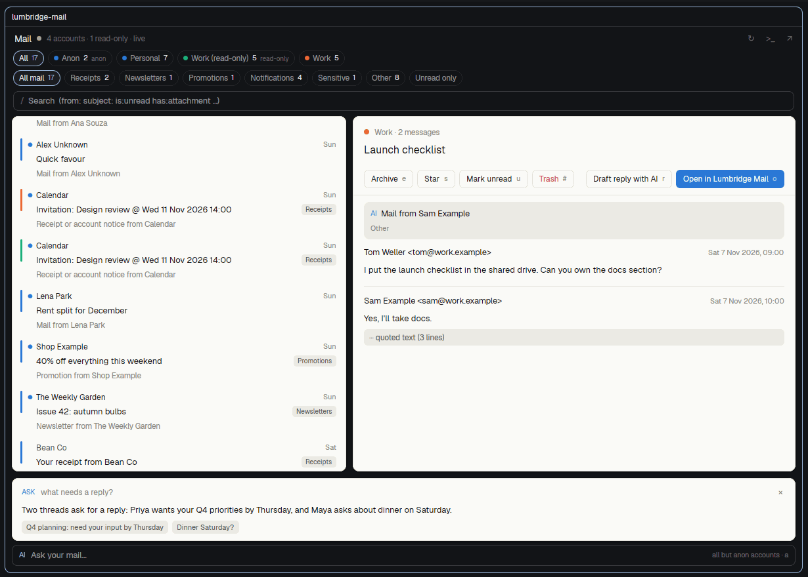
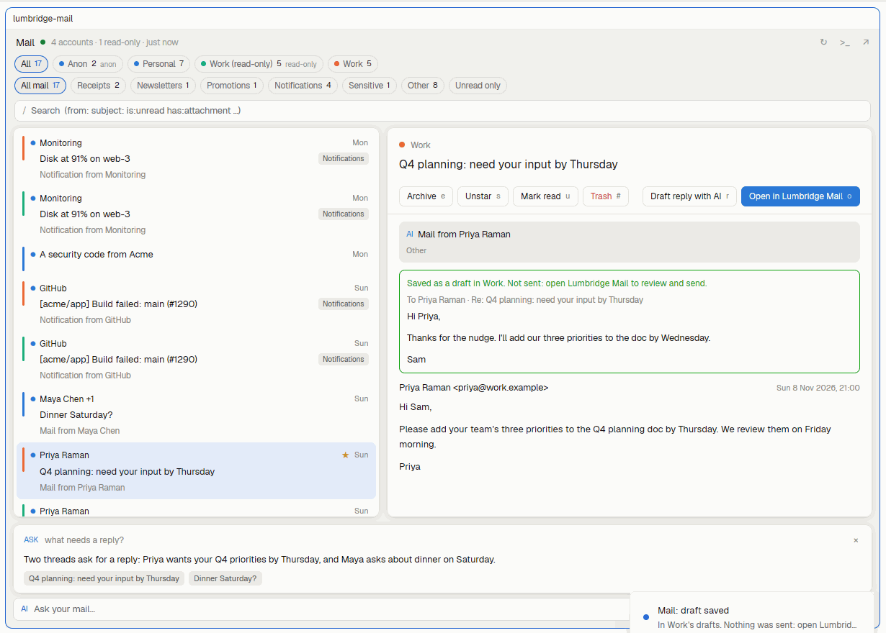

# lumbridge-mail

Lumbridge Mail in a Lumbridge pane. Reads and acts through `lbmail --json --agent`, the CLI of
`lumbridge-maild` (repo lumbridge-mail). Writing and sending stay in the full app
window, one click away.

(Both shots are from a sandboxed app on a private X display, fed by `tests/fixtures/lbmail/fake-lbmail.mjs`:
the demo provider's made-up mail, no real accounts.)

## Open it

| How | What you get |
|---|---|
| `ctrl-alt-m` | Mail as a dialog over the window (press again to close) |
| `+` menu → **Mail (lbmail)** | `lbmail ls` in a new terminal (config/programs.json) |
| shell | `lumbridge-app do tab.new '{"mod":"lumbridge-mail","name":"Mail"}'` |

## What it shows

- **Top line**: the daemon and accounts in one line (paused, offline, read-only, live / how old), ↻,
  `>_` (lbmail in a terminal), ↗ (the app window).
- **Filters**: All (unread across every non-anon account), one chip per account with its colour, unread
  count and a badge (paused, offline, read-only, anon); AI categories with unread counts; Unread only;
  search (`/`, the store's operators: `from:`, `subject:`, `is:unread`, `has:attachment`, `before:` …).
- **Thread list**: account colour bar, unread dot, sender (+N), star, attachment, time; subject with its
  category chip; the AI's one line (with "needs a reply" and a suspicious warning). **Sensitive mail is
  only its fixed line** ("A security code from Acme"): no sender, no summary, no snippet.
- **Reader**: each message's sender, date, attachments and plain text from `lbmail show`, drawn as text
  only (every Markdown character escaped: no links, HTML or formatting can come out of mail). Quoted
  history folds into "··· quoted text (N lines)". `lbmail show` already leaves quoted history out, so
  this mostly catches `>` runs and "On … wrote:" tails it lets through.
- **AI strip**: the thread's triage (one line, category, needs a reply, due date, suspicious warning).
  **Ask your mail** at the bottom (`a`): `lbmail ask`, limited to the picked account; the answer opens
  above it with its source threads as chips (click opens one).
- **Actions** (disabled with the reason on read-only accounts): Archive `e`, Star `s`, Mark read / unread
  `u`, Trash `#` (press twice), **Draft reply with AI** `r` (asks how, then `lbmail draft … --save`: it
  says "Saved as a draft in <account>. Not sent" and shows the text; sensitive mail never goes to a
  model), **Open in Lumbridge Mail** `o`.
- **States**: lbmail missing (links to its install guide), daemon not running (offers **Start the mail daemon**, which
  asks once more, then starts the `lumbridge-maild` user unit if installed, else the program, detached),
  no accounts (offers the app's first-run screen or `lbmail account add` in a terminal), account paused
  (sign-in needed) or offline, AI off, empty inbox / filter / search.

Keys while it has the keyboard (click a row, or `pane.go` onto it: `"focusable": true`): `j`/`k` or
↓/↑ move, Enter opens, Esc goes back / clears the search, `e s u # / a r o`, `g` refresh. Typing in a
box never triggers them.

## How it stays fresh

It waits on `lbmail tail --count 1 --timeout 240` (one daemon event, or four minutes) and refreshes then,
never sooner than 15 s after the last refresh. With no daemon it looks again every 30 s; without lbmail
every 60 s. A refresh is `status`, `accounts`, one `counts` per account (unread), `counts` for the filter
and `ls`/`search`. Mod copies keep running when hidden (the app has no visibility signal), so the hidden
cost is one idle `lbmail tail` and a refresh per event.

## What it cannot do

- **Send.** lbmail has no send, and the daemon refuses sends from agents. Compose and send in the app.
- **Show sensitive mail**: an agent connection only ever gets its fixed line.
- **Open the app at a thread**: `lumbridge-mail` takes no thread argument; ↗ opens the window.
- **HTML mail**: the reader shows lbmail's plain text, links as text (not clickable).
- **Attachments**: listed by name, not opened.
- **Edit or send drafts**: AI drafts are saved; edit and send them in the app.
- **Act on many threads at once**, undo, move to folders or labels, mark spam.

## Props, shared keys, commands

Props: `machine` (a Lumbridge machine to run lbmail on; default this computer), `account` (start
filtered), `compact: true` (a narrow column: the reader replaces the list), `paper: false` (theme cards
instead of the light paper cards), `lbmail` (an argv prefix, for tests). Shared: `lumbridge.mail.lbmail`
(lbmail argv prefix), `lumbridge.mail.app` (the app's argv). Commands, for keys and
`lumbridge-app do "lumbridge-mail.<cmd>"`: `refresh next prev open open:<account/thread> back archive star
read trash trash! draft draft:<how> ask:<question> search:<query> account:<id|all> category:<c|all>
unread app start focus`.

